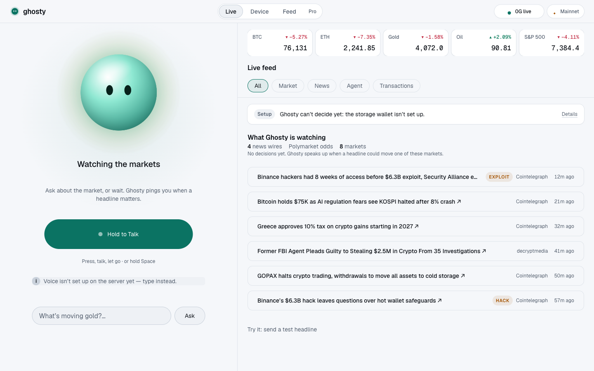
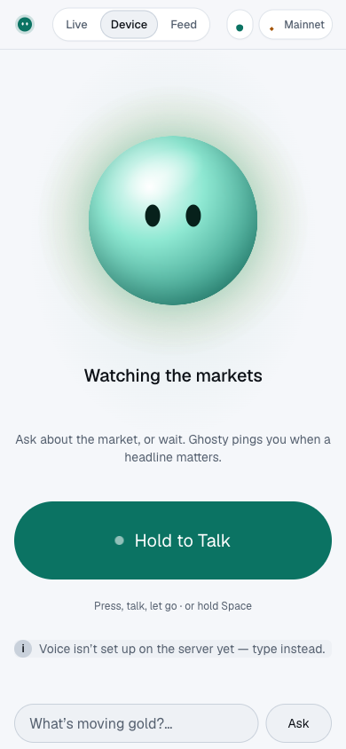
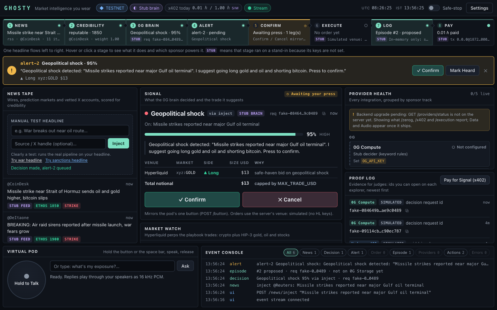

# Ghosty

Ghosty is a wearable ESP32 voice pod that hosts a private, user-owned trading copilot. It reads the news for you, scores how credible each signal is, speaks an alert through its own speaker, and executes the trade from its own wallet when you press one button. The decision loop runs on 0G Compute, every decision is logged to 0G Storage, before each shock decision the agent buys a headline-intelligence bundle from an independent x402 merchant on Hedera (USDC or HBAR, verified on chain, logged to an HCS topic), and trades go to Hyperliquid perps (with a Uniswap spot leg). If the 0G brain is unreachable, the pod says so and refuses to trade.

Built at ETHGlobal Mumbai, Nov 6–8 2026.

## Demo

> Demo video and GIF go here before submission.

<!-- TODO: add hardware/photos/demo.gif and uncomment

-->

- Video (≤ 3 min): _TODO link_
- HashScan x402 payment (agent buys intel before a 0G decision, 0.01 USDC, mirror-verified): [0.0.9185802@1793984888.876950864](https://hashscan.io/testnet/transaction/0.0.9185802-1793984888-876950864) · HCS audit topic: [0.0.11342727](https://hashscan.io/testnet/topic/0.0.11342727) · walkthrough: [docs/hedera.md](docs/hedera.md)
- 0G Storage episode log: _TODO root hash / storagescan link_

## How it works

```
[ESP32-CAM pod] --WAV over HTTP POST--> [server: Fastify/Express TS]
   button GPIO2                         ├─ STT (Groq whisper; 0G Whisper if router exposes audio)
   INMP441 mic  GPIO14/15/13             ├─ news ingest: RSS (CoinDesk/Cointelegraph/TheBlock/Decrypt),
   MAX98357A amp GPIO14/15/12            │    CryptoPanic, Polymarket Gamma, Grok x_search (optional)
   speaker, LiPo→TP4056→5V boost         ├─ credibility: Ethos score per handle/address (optional)
                                         ├─ decision loop: 0G Compute chat completion (request ID logged)
<--raw PCM s16le 16k over HTTP--         ├─ memory: encrypted (AES-256) blobs on 0G Storage; episode log per decision
                                         ├─ payments: x402 client buys intel from the Signal Desk (USDC/HBAR on Hedera testnet)
                                         ├─ execution: Hyperliquid API wallet (@nktkas/hyperliquid) opens perp
                                         │    (xyz:GOLD / xyz:WTI long, BTC short) — main venue
                                         ├─ spot leg: viem + Uniswap Trading API (Arbitrum/Base) swap → USDC
                                         │    before funding, or USDC → PAXG safe-haven (Uniswap track)
                                         └─ safe-stop: if 0G unreachable → speak "brain offline", block trade
```

1. The server ingests news and prediction-market moves, then weights each item by source credibility.
2. A 0G Compute call decides whether the signal is actionable and which playbook applies (for example, a geopolitical shock maps to long gold / oil perps and short BTC).
3. The server synthesizes a short spoken alert and streams it to the pod as raw PCM.
4. The user presses the button. The server places the order on **Hyperliquid** (main venue; HIP-3 markets on trade.xyz cover gold, oil, and stock perps 24/7) and runs the spot leg through the **Uniswap** Trading API.
5. The decision, its 0G request ID, and the result are written as an episode to **0G Storage**.

Full detail: [docs/architecture.md](docs/architecture.md).

## Hardware

### Bill of materials

| Part | Qty | Purpose | Status |
|---|---|---|---|
| ESP32-CAM (AI Thinker) | 1 | Main MCU, WiFi, 4 MB PSRAM | Bought |
| ESP32-CAM-MB base board | 1 | USB flashing and serial | Bought |
| INMP441 I2S MEMS mic | 1 | Voice input | Bought |
| MAX98357A I2S amp | 1 | Speaker driver | Bought |
| Mini speaker | 1 | Voice output | Bought |
| 3.7 V 500 mAh LiPo | 1 | Battery | Bought |
| TP4056 charger | 1 | LiPo charging and protection | Bought |
| Push button | 1 | Push-to-talk and trade confirm | Bought |
| 5 V boost converter | 1 | Lift LiPo to 5 V for the board and amp | To buy |
| 470–1000 µF capacitor | 1 | Absorb WiFi and audio current spikes | To buy |
| Vibration motor + 2N2222 + 1 kΩ + 1N4148 | 1 set | Haptic alert (optional) | To buy |
| Slide switch | 1 | Power switch (optional) | To buy |

Full list with notes: [hardware/BOM.md](hardware/BOM.md).

### Wiring

| Module | Module pin | ESP32-CAM pin |
|---|---|---|
| INMP441 | VDD / GND / L/R | 3V3 / GND / GND |
| INMP441 | SCK / WS / SD | GPIO14 / GPIO15 / GPIO13 |
| MAX98357A | VIN / GND | 5V / GND |
| MAX98357A | BCLK / LRC / DIN | GPIO14 / GPIO15 / GPIO12 |
| Speaker | + / − | Amp + / − |
| Button | one leg / other leg | GPIO2 / GND (`INPUT_PULLUP`) |
| LiPo | + / − | TP4056 B+ / B− |
| TP4056 | OUT+ / OUT− | 5 V boost in → boost out to 5V / GND |

Mic and amp share one I2S port in full duplex: BCLK and WS are common, data runs on separate pins, 16 kHz with 32-bit slots.

> **Warning: boot strapping pins**
> - **GPIO12** sets the flash voltage at reset. If it is HIGH at reset the board boot-loops with `flash read err`. Only the amp's DIN (an input) goes here. Never put the mic's SD output on GPIO12.
> - **GPIO2** must be LOW or floating to enter download mode. Wire the button GPIO2 → GND with `INPUT_PULLUP`. Never tie GPIO2 to 3V3.
> - GPIO2, 4, 12, 13, 14, 15 are the SD card pins. **Never call `SD_MMC.begin()`.**

> **Power note:** a LiPo (3.0–4.2 V) on the 5V pin browns out under WiFi plus audio, because the onboard AMS1117 needs about 1.1 V of headroom. Use LiPo → TP4056 → 5 V boost → 5V pin, feed the amp VIN from the boost, and add a 470–1000 µF capacitor across 5V/GND.

Full guide with power and test order: [hardware/wiring.md](hardware/wiring.md).

## Firmware quick start

1. Install **Arduino IDE 2.x**.
2. In *Preferences → Additional boards manager URLs* add:
   `https://raw.githubusercontent.com/espressif/arduino-esp32/gh-pages/package_esp32_index.json`
3. *Boards Manager* → install **esp32 by Espressif** (CI uses core 3.3.12).
4. Select board **AI Thinker ESP32-CAM**. On Windows you may need the CH340 USB driver for the MB base board.
5. Link the shared library into your sketchbook:
   ```bash
   ./firmware/scripts/link-lib.sh
   ```
6. Create your secrets file (gitignored):
   ```bash
   cp firmware/libraries/GhostyBoard/src/secrets.h.example firmware/libraries/GhostyBoard/src/secrets.h
   # edit WiFi SSID/password and server URL
   ```
7. Open `firmware/sketches/01_Blink/01_Blink.ino` and upload. Work through the sketches in order.

Flashing: use the ESP32-CAM-MB base board, or pull GPIO0 to GND while resetting.

## Server quick start

Requires Node 22+ and npm.

```bash
cd server
cp .env.example .env   # fill in keys as you need each provider
npm ci
npm run doctor         # which providers are live, and the exact URL for each missing key
npm run dev            # or: npm run start:live (build + start)
curl localhost:3000/health
```

### Live mode vs test mode

The server runs on **real data only**. `GHOSTY_MODE=live` is the default: each provider is the real implementation when its keys are in `server/.env` (template: [`server/.env.example`](server/.env.example)), and otherwise answers `503 {"error":"not_configured","provider","missingEnv"}`. Nothing is faked: without `OG_API_KEY` there is no brain, so safe-stop is engaged and no decision is made. Keyless sources are on by default in live mode: RSS + Polymarket news (`NEWS_LIVE=true`), Ethos credibility (`ETHOS_ENABLED=true`) and Hyperliquid market data.

`GHOSTY_MODE=test` is set by `npm test` only. It swaps in deterministic offline fakes (tone TTS, keyword decider, fake venue, canned headlines) so the suite never touches the network.

| Provider | Keys that enable it | Where to get them | Live mode without them |
|---|---|---|---|
| Speech-to-text (Groq Whisper) | `GROQ_API_KEY` | https://console.groq.com/keys | `/voice` answers `503 not_configured` |
| Text-to-speech (ElevenLabs) | `ELEVENLABS_API_KEY` (optional `ELEVENLABS_VOICE_ID`) | https://elevenlabs.io/app/settings/api-keys | OpenAI TTS if `OPENAI_API_KEY` is set, else `503 not_configured` |
| Text-to-speech fallback (OpenAI) | `OPENAI_API_KEY` | https://platform.openai.com/api-keys | Optional |
| Live news (RSS + Polymarket) | none (`NEWS_LIVE=true` by default) | n/a | Polymarket is blocked on many Indian ISPs: it shows `offline` |
| CryptoPanic | `CRYPTOPANIC_TOKEN` | https://cryptopanic.com/developers/api/ | Left out of the feed |
| Grok x_search (X posts) | `XAI_API_KEY` | https://console.x.ai | Left out of the feed |
| Ethos credibility | none (`ETHOS_ENABLED=true` by default) | n/a | Weights unknown if disabled |
| 0G Compute decider | `OG_API_KEY` (+ `OG_ROUTER_URL`, `OG_MODEL`) | https://pc.0g.ai (mainnet) or https://pc.testnet.0g.ai | Safe-stop: `503 brain_offline`, no decision |
| 0G Storage memory + episode log | `OG_PRIVATE_KEY` (optional `OG_MEMORY_KEY`) | Any EVM key, funded at https://faucet.0g.ai | `503 not_configured` |
| Hedera agent wallet (x402 payer) + HCS audit | `HEDERA_ACCOUNT_ID`, `HEDERA_PRIVATE_KEY`, `HEDERA_HCS_TOPIC_ID`, `HEDERA_HCS_SUBMIT_KEY` (written by `npm run hedera:setup` from `HEDERA_TREASURY_*`, see [docs/hedera.md](docs/hedera.md#4-accounts-and-keys)) | https://portal.hedera.com (testnet faucet) | `/sim/pay-signal` answers `503 not_configured` |
| Signal Desk merchant (`npm run signal-desk`) | `X402_PAY_TO` (a **second** testnet account, USDC-associated by `npm run hedera:setup`) | https://portal.hedera.com | desk answers `503 payments_not_configured` |
| Hyperliquid perps | `HL_MASTER_ADDRESS`, `HL_AGENT_PRIVATE_KEY` (+ `HL_TESTNET`, `HL_DEXES`, `HL_FALLBACK_COINS`) | API wallet approved at https://app.hyperliquid-testnet.xyz/API | Confirm answers `503 not_configured`; market listing stays real |
| Uniswap spot leg | `UNISWAP_API_KEY`, `EVM_PRIVATE_KEY`, `UNISWAP_SPOT_LEG=true` (+ `EVM_RPC_URL`, `EVM_CHAIN_ID`) | https://developers.uniswap.org/dashboard | Spot step fails with `not_configured` |

**Doctor.** `npm run doctor` loads `server/.env`, runs the same probes as `GET /providers/status`, and prints a table per track (state, detail, missing env, next action with the URL to get the key). It never prints secrets and always exits 0.

**Terminal.** `GET /providers/status` (provider health), `GET /market/snapshot` and `GET /market/history` (Hyperliquid prices with no keys; `MARKET_DATA_NETWORK=mainnet` by default for display, orders follow `HL_TESTNET`), plus SSE `providers` and `market` events on `/events`. When `terminal/dist/index.html` exists the server serves the terminal at `/` (`TERMINAL_DIST` overrides the path); CORS allows the Vite dev server at `http://localhost:5173` in live mode. See [docs/api.md](docs/api.md#terminal-providers-and-market-data).

Status endpoints show which mode each integration is in: `GET /zerog/status`, `GET /x402/status`, `GET /execution/markets` (see [docs/api.md](docs/api.md#integration-status)). Pre-flight checks: `npm run doctor`, `npm run hl:check` (Hyperliquid markets and margin, read-only) and `npm run hedera:setup` (idempotent custody split: treasury, agent hot wallet, USDC association, HCS topic) and `npm run x402:demo` (one real intel purchase from the Signal Desk, appended to [docs/evidence.md](docs/evidence.md)).

No pod yet? Open http://localhost:3000/sim for the virtual pod (hold-to-talk, inject headlines, confirm trades, live state), or use `npm run pod -- help`. See [docs/simulator.md](docs/simulator.md).

## Live view (web UI)

No hardware yet, so the web UI stands in for the pod. Open it and you see two things: **the device** (a ghost orb that listens, thinks on 0G, speaks and alerts, with one big button) and **the feed** (cards that keep popping in: market moves, headlines, the agent's decisions, transactions). Everything comes from the running server; nothing is made up.



| Route | What it is |
|---|---|
| `/` | Split view: Device (left) + Feed (right). Stacks on phones, device first |
| `/device` | The pod, full screen. Open it on a phone as the pod stand-in |
| `/feed` | The feed only |
| `/pro` | The dense terminal (every panel at once, described below) |

```bash
# terminal 1: the server (port 3000)
cd server && npm run dev
# terminal 2: the web UI (http://localhost:5173, proxies API calls to the server)
cd terminal && npm i && npm run dev
```

**Device.** Hold the button (or the space bar) to talk: the orb follows your mic level, then "Thinking on 0G…", then speaks the reply with the orb pulsing to the audio. When an alert arrives the orb ripples amber, chimes, buzzes (where the phone supports it) and reads the alert; a tap confirms the trade, "Not now" cancels. Without `GROQ_API_KEY` + `ELEVENLABS_API_KEY` it says so and you can type instead.

**Feed cards.** *Market move* (a watched asset moved ≥ 0.25% in 60 s or broke its 1 h high/low, at most one card per asset per 2 min), *Headline* (source, age, Ethos credibility, shock tag, Polymarket odds), *Ghosty · 0G* (thinking, then the decision with confidence, rationale, suggested legs and the 0G request id, or why there was no decision), *Alert* (what the pod was told), *Transactions* (Hyperliquid orders, Uniswap swaps, Hedera x402 payments, 0G Storage episodes, with explorer links and a track label) and *System* (providers going on/offline, safe-stop). Filter with the chips; hover or scroll down to pause, then "N New" jumps back. `?moveThreshold=0.05` lowers the move threshold for a demo (the feed header flags it).

Design system, references and tokens: [docs/design/ghosty-design.md](docs/design/ghosty-design.md).

<p>
  
  
</p>

## Terminal (`/pro`)

The dense market intelligence terminal drives and explains the whole system in one screen, with or without the pod.



Point the UI at another server with `VITE_GHOSTY_URL=http://192.168.1.50:3000 npm run dev`, or set the server URL and device token under **Settings** in `/pro` (kept in the browser). `npm run build` writes `terminal/dist/` for the server to serve at `/`.

| Panel | What it shows |
|---|---|
| Top bar | Network (testnet / mainnet), brain status (0G live, stub, or safe-stop), x402 spend today against the cap, UTC and IST clocks, the safe-stop switch, settings |
| Pipeline strip | News → Credibility → 0G Brain → Alert → Confirm → Execute → Log → Pay. Each stage lights up as its event arrives and shows the latest value or id. Hover or click a stage for a one-line explanation and the sponsor it maps to. `STUB` marks a stage that ran on a stand-in because its keys are not set |
| News tape | Headlines with source, age, Ethos or source-table credibility and a shock tag (WAR, STRIKE, SANCTION, HACK, DEPEG). The "manual test headline" box runs the real pipeline on your own headline |
| Signal | The latest decision: signal, confidence, rationale, the order ticket (venue, market, side, size) and Confirm / Cancel buttons that mirror the pod's one button |
| Market watch | Hyperliquid mids, 24 h change, funding, open interest and a 24 h sparkline for BTC, ETH, gold, oil, stocks (from `/market/snapshot`, `/market/history` and the SSE `market` event) |
| Provider health | Every integration grouped by track (0G, Hedera, Uniswap, Hyperliquid, Data, Audio) with a state and the env vars still missing |
| Proof log | Evidence for judges, newest first: 0G request ids, 0G Storage roots, Hedera x402 transactions (HashScan), Hyperliquid orders, Uniswap swaps. Simulated ids are labelled and never linked |
| Virtual pod | Hold to talk (button or space bar): records 16 kHz mono WAV, posts it to `/voice`, plays the PCM reply and shows transcript, signal, request id and latency. You can also type a question |
| Event console | Every SSE event and terminal action, filterable by type |

No placeholder data: when a provider is missing the panel says so (for example "Not configured: set GROQ_API_KEY" or "Brain offline: trading blocked (safe-stop)").

## Sketch roadmap

| # | Sketch | What it proves | Status |
|---|---|---|---|
| 01 | `01_Blink` | Toolchain and upload work (red LED on GPIO33) | Scaffolded |
| 02 | `02_WiFiTest` | WiFi joins with `secrets.h` | Scaffolded |
| 03 | `03_MicTest` | INMP441 over full-duplex I2S, RMS level meter | Scaffolded |
| 04 | `04_SpeakerTest` | MAX98357A plays a sine tone | Scaffolded |
| 05 | `05_RecordPlayback` | 5 s recorded into PSRAM and played back | Scaffolded |
| 06 | `06_CloudVoice` | Hold button → POST WAV → stream PCM reply | Skeleton |

"Scaffolded" means it compiles in CI but has not yet been verified on the team's hardware.

## API contract

| Method | Path | Request | Response |
|---|---|---|---|
| `GET` | `/health` | — | `{"ok":true,"version":"0.1.0","safeStop":false}`; `safeStop: true` = 0G unreachable, trading blocked |
| `POST` | `/voice` | WAV body (16 kHz, 16-bit, mono) as `audio/wav` or `application/octet-stream`; `X-Device-Token` when `DEVICE_TOKEN` is set | `200 application/octet-stream`: raw PCM s16le, 16 kHz, mono, with headers `x-sample-rate`, `x-request-id`, `x-signal`. `400` bad WAV, `401` bad token, `503 {"error":"brain_offline"}` (no audio) |
| `POST` | `/button` | JSON `{"action":"confirm"\|"cancel"}`, same token header | `200 {action, requestId, signal, executed, actions, orders}`; with nothing pending it decides from current news. `400`, `401`, `503 brain_offline` |

The device streams the PCM reply straight to I2S in 1–2 KB chunks. No MP3 decoding on the device. On `503` (safe-stop) the pod plays nothing and blinks the red LED 3 times. Details: [docs/api.md](docs/api.md).

## Hackathon tracks

| # | Track | How Ghosty qualifies |
|---|---|---|
| 1 | **0G — Physical AI: Agents with a Body** | Real wearable. Every decision is a 0G Compute call with its request ID logged; each decision is written as an episode to 0G Storage; encrypted memory on 0G Storage; safe-stop when 0G is unreachable. |
| 2 | **Hedera — AI Agents That Pay: x402** | Before each shock decision the agent's hot wallet buys a headline-intelligence bundle from the Signal Desk (a separate x402 merchant) in USDC (HTS) or HBAR on `hedera:testnet`, with no human approval, inside per-asset caps. Each payment is re-checked on the mirror node and logged with the decision to an HCS topic. Tx and topic links under [Demo](#demo); walkthrough in [docs/hedera.md](docs/hedera.md). |
| 3 | **Uniswap — Build with Uniswap** | The spot leg of each trade runs through the Uniswap Trading API. Code: [`server/src/wallet/uniswap.ts`](server/src/wallet/uniswap.ts). Feedback: [FEEDBACK.md](FEEDBACK.md). |
| stretch | Arkiv + Swarm bonus, EF Anon-RPC | Public market-event index on Arkiv; chain reads via Anon-RPC. Only if time allows. |

Execution venue: **Hyperliquid** (not a sponsor). HIP-3 perps for gold, oil, and stocks, opened from an approved API wallet.

**What breaks without 0G:** the decision loop and episode log — the device safe-stops and refuses to trade.

Per-track checklists and doc links: [docs/tracks.md](docs/tracks.md).

## Repo layout

```
ghosty/
├─ README.md           this file
├─ PLAN.md             hackathon plan: milestones, task board, demo script, risks
├─ CONTRIBUTING.md     commit, branch, and PR rules
├─ FEEDBACK.md         Uniswap track feedback
├─ hardware/           BOM, wiring guide, photos
├─ firmware/
│  ├─ libraries/GhostyBoard/   shared pins + secrets (local Arduino library)
│  ├─ sketches/01_…06_…        bring-up sketches, in test order
│  └─ scripts/link-lib.sh      symlink the library into ~/Documents/Arduino/libraries
├─ server/             Node + TypeScript service (voice, news, agent, payments, execution)
├─ terminal/           Vite + React web UI: Live view (device + feed) and the /pro terminal
├─ docs/               architecture, API, setup, troubleshooting, demo script, tracks, research
└─ .github/            CI workflows, issue and PR templates
```

Plan and task board: [PLAN.md](PLAN.md). How to contribute: [CONTRIBUTING.md](CONTRIBUTING.md).

## Team

| Name | Role | Contact |
|---|---|---|
| _TODO_ | Firmware + hardware | _TODO_ |
| _TODO_ | Server + agent | _TODO_ |
| _TODO_ | Onchain integrations | _TODO_ |

## License

[MIT](LICENSE)
