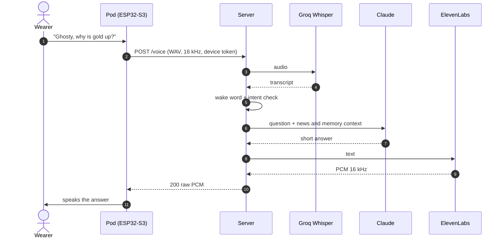
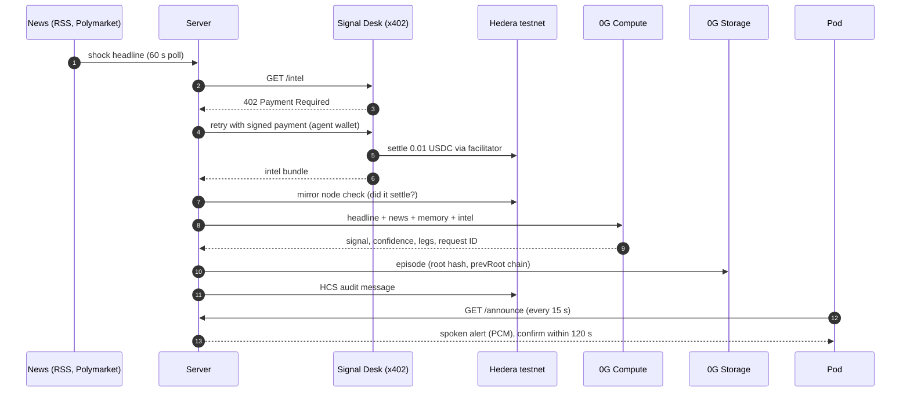
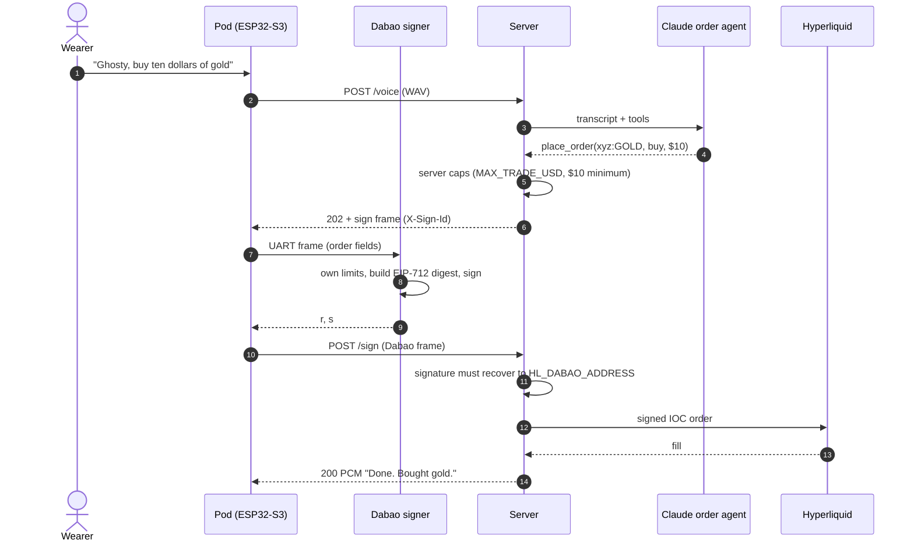

<p align="center">
  
</p>

<h3 align="center">Market intelligence you wear.</h3>

<p align="center">
  <a href="https://github.com/codeakki/ghosty/actions/workflows/server.yml"></a>
  <a href="https://github.com/codeakki/ghosty/actions/workflows/terminal.yml"></a>
  <a href="https://github.com/codeakki/ghosty/actions/workflows/firmware.yml"></a>
  <a href="LICENSE"></a>
</p>

<p align="center">
  <a href="https://ghosty-sepia.vercel.app"><b>Live app</b></a> ·
  <a href="https://ghosty-sepia.vercel.app/device"><b>Device</b></a> ·
  <a href="docs/architecture.md"><b>Architecture</b></a> ·
  <a href="docs/evidence.md"><b>Evidence</b></a> ·
  <b>Demo video</b> (TODO)
</p>

---

## What it is

Ghosty is a small voice pod you wear, plus a server that does the heavy lifting. It reads market news for you, scores how credible each headline is, and speaks up when something moves gold, oil, crypto or stocks. Alert decisions come from **0G Compute**, every decision is logged to **0G Storage** and a public **Hedera** topic, and before each shock decision the agent pays an independent merchant for a second opinion over **x402**. Trades go to **Hyperliquid** perps, with an optional **Uniswap** spot leg. The trading key lives in a separate signer chip, the **Dabao** (Baochip-1x), which checks every order against its own limits before it signs.

Built at ETHGlobal Mumbai, Nov 6 to 8, 2026.

### The 30-second story

1. **A headline lands:** "Missile strikes near Hormuz." The server polls RSS and Polymarket every 60 s and a shock detector flags it.
2. **Ghosty buys a second opinion.** Its Hedera agent wallet pays the Signal Desk 0.01 USDC over x402 for an intel bundle (source credibility, outlet count, severity). The payment is re-checked on the mirror node.
3. **0G decides.** Headline, news window, the wearer's memory and the paid bundle go to 0G Compute. It returns a signal, a confidence and legs (long gold, long oil, short BTC), sized to the wearer's cap.
4. **Logged before it is spoken.** The decision goes to 0G Storage as an episode and to the HCS audit topic.
5. **The pod speaks:** "Geopolitical shock. I suggest long gold. Press to confirm." Nothing trades without a confirm within 120 s.
6. **Or just say it:** "Ghosty, buy ten dollars of gold." Claude turns the words into an order, the Dabao checks and signs it, the server submits it to Hyperliquid and speaks the fill.

## Try it

| What | Where |
|---|---|
| Web app (landing, live feed, simulate) | https://ghosty-sepia.vercel.app |
| The pod in your browser (hold to talk) | https://ghosty-sepia.vercel.app/device |
| Virtual pod without hardware, on a local server | `http://localhost:3000/sim` ([docs/simulator.md](docs/simulator.md)) |
| Talk to the hosted server with curl | [docs/try-the-server.md](docs/try-the-server.md) |

**Try Ghosty as a guest.** In the Live view, press **Try Ghosty as a guest** for a 24-hour pass that can ask Ghosty anything about markets and news, by voice or text. Guests never trade, confirm alerts or pay for intel; turns are rate-limited per guest and per day, and the pass expires. The server offers guest passes only with `GUEST_ACCESS=true`. Limits and the full safety model: [docs/api.md#guest-access](docs/api.md#guest-access).

**Owners** press **I have a device token**: action routes (voice orders, confirm, inject news) need the owner's device token, which the app keeps in that browser.

**Pod mirror.** When the physical pod is talking, the Device orb on the web follows it live (listening, thinking, speaking with the reply's loudness) and says "Live from the pod". See [docs/api.md#pod-mirror](docs/api.md#pod-mirror).

The orb, header mark and favicon are the Ghosty ghost from the brand logo ([`ghost.ts`](terminal/src/live/brand/ghost.ts)).

## How it works

<p align="center">
  
</p>

- **Pod.** The ESP32-S3 records, plays audio and relays signing frames. It holds WiFi credentials and a device token, never a trading key.
- **Dabao signer.** Holds the Hyperliquid API-wallet key, enforces its own limits and signs. Talks to the ESP32-S3 over three wires (UART).
- **Server.** One Node 22 + TypeScript (Fastify) process on AWS ECS in Mumbai. Speech, news, decisions, payments, execution, logs, and the web app.
- **Teal paths** mark the hardware trust boundary and the paid-intel path. Networks are config, not code: the hosted server runs the 0G mainnet router, 0G Storage on Galileo testnet, Hedera testnet, Hyperliquid mainnet and Base mainnet. Code defaults are testnets.

Three rules behind the design:

- **Separation of powers.** 0G decides alerts. Claude talks and parses spoken orders. The Dabao signs. The wearer confirms.
- **Real or nothing.** In live mode each provider is real or answers `503 not_configured`. Fakes exist only under `npm test`. No 0G brain means safe-stop: no decision, no alert trade.
- **Everything leaves a trail.** 0G request IDs, 0G Storage root hashes, HashScan transactions, HCS messages and Hyperliquid order IDs are exposed over the API and in the app.

More: [docs/architecture.md](docs/architecture.md) · [docs/api.md](docs/api.md)

## Hardware

<p align="center">
  
</p>

| Signal | ESP32-S3 | Other end | Notes |
|---|---|---|---|
| I2S bit clock | GPIO4 | INMP441 SCK + MAX98357A BCLK | One I2S port, full duplex |
| I2S word select | GPIO5 | INMP441 WS + MAX98357A LRC | Shared |
| I2S data in | GPIO6 | INMP441 SD | Mic L/R to GND = left slot |
| I2S data out | GPIO7 | MAX98357A DIN | GAIN and SD not wired |
| Button | GPIO15 | Button to GND | `INPUT_PULLUP`, pressed = LOW |
| UART TX | GPIO17 | 1 kΩ to Dabao PB13 (UART2 RX) | 115200 8N1 |
| UART RX | GPIO18 | 1 kΩ from Dabao PB14 (UART2 TX) | |
| Ground | GND | Mic, amp, button, Dabao | Common ground needed for UART |
| 3.3 V | 3V3 | INMP441 VDD, MAX98357A VIN | The 5V pin is dead on USB power on this clone |

Avoid GPIO0/3/45/46 (strapping), GPIO19/20 (native USB) and GPIO26 to 37 (flash and octal PSRAM). Source of truth: [`pins.h`](firmware/libraries/GhostyBoard/src/pins.h).

**Parts.** ESP32-S3 N16R8 (16 MB flash, 8 MB PSRAM), Dabao board (Baochip-1x), INMP441 I2S mic, MAX98357A I2S amp, 40 mm speaker, push button, two 1 kΩ resistors. For battery use: 3.7 V LiPo, TP4056, 5 V boost and a 470 to 1000 µF capacitor (boost and capacitor still to buy). Ghost enclosure STLs in [hardware/enclosure/](hardware/enclosure/README.md). Full list: [hardware/BOM.md](hardware/BOM.md). Wiring and power: [hardware/wiring.md](hardware/wiring.md). Bring-up log: [hardware/bringup-esp32s3.md](hardware/bringup-esp32s3.md).

### Why the signer is a separate chip

The [Dabao](https://www.crossbar-inc.com/pages/dabao-hackathon) is an open-hardware board around the Baochip-1x (RISC-V, on-chip RRAM, TRNG). Ghosty runs a small bare-metal C signer on it ([`firmware/dabao/`](firmware/dabao/)).

- **The networked part never holds the key.** The ESP32-S3 runs WiFi, TLS and HTTP and only moves bytes. No UART command reads or sets the key.
- **The chip refuses bad orders on its own.** It never signs a hash it is handed. It receives order fields, applies its limits (5-asset allowlist, $15 per order, $50 per UTC day, one signature per 10 s, mainnet only, increasing nonce), then rebuilds the exact EIP-712 bytes Hyperliquid hashes.
- **The server cannot trade alone.** With `HL_SIGNER=dabao` the server holds no Hyperliquid key and only submits a signature that recovers to `HL_DABAO_ADDRESS`.
- **Revocable.** The Dabao's address is a Hyperliquid API wallet: it can trade, cannot withdraw, and the owner can revoke it.

Today `AUTO_APPROVE` is `1` in the signer (hands-free). Set it to `0` and the chip waits up to 30 s for a press on its own button (PB3) before each signature. The key sits in RRAM and is signed in software (micro-ecc); the chip's key store and crypto accelerators are a next step.

## Flows

**1. Voice question, Claude answer**



**2. Shock headline, paid intel, 0G decision, alert**



**3. Spoken order, signed on the Dabao, Hyperliquid fill**

Needs `VOICE_ORDERS_ENABLED=true` and `HL_SIGNER=dabao` with `HL_DABAO_ADDRESS` set.



On the **button path** (an alert confirmed in the web Device view, `/pro` or `curl /button`), the executor runs the Uniswap spot leg first (when `UNISWAP_SPOT_LEG=true`), then the Hyperliquid legs. From reading the code, the Dabao relay only runs inside an open pod request (`/voice` or `/sign`), so button-confirmed perp legs need `HL_SIGNER=key` today; with `HL_SIGNER=dabao` they are rejected with "no pod is connected". Not yet verified on the hosted server.

## Services

| Service | Used for | Why this one | Network (hosted) | Code |
|---|---|---|---|---|
| 0G Compute | Alert decisions with a request ID per call | Verifiable inference, per-call IDs | Mainnet router, `glm-4.7` | [`agent/decide.ts`](server/src/agent/decide.ts), [`safety/safeStop.ts`](server/src/safety/safeStop.ts) |
| 0G Storage | Encrypted memory (AES-256-GCM), chained episode log | User-owned storage, root hashes as evidence | Galileo testnet | [`agent/`](server/src/agent/) |
| Claude Sonnet 5.5 | Spoken Q&A, news scout, spoken orders via tools | Strong tool use, short spoken answers | Anthropic API | [`claude/`](server/src/claude/) |
| Groq Whisper | Speech to text | Fast and cheap | Cloud API | [`audio/`](server/src/audio/) |
| ElevenLabs | Text to speech as `pcm_16000` | Raw PCM needs no decoding on the pod | Cloud API (OpenAI TTS fallback) | [`audio/`](server/src/audio/) |
| RSS, Polymarket, Ethos | Headlines, odds, source credibility | Keyless, fast-moving signals | Public APIs | [`news/`](server/src/news/), [`credibility/`](server/src/credibility/) |
| Hedera + Signal Desk | x402 intel purchase, mirror verification, HCS audit topic | Cheap fast finality, native USDC, public log | Testnet | [`payments/`](server/src/payments/) |
| Blocky402 | x402 facilitator (verify, settle, pays fees) | Supports `hedera:testnet` | Testnet | [`payments/x402Server.ts`](server/src/payments/x402Server.ts) |
| Hyperliquid | Perps incl. HIP-3 `xyz:GOLD`, `xyz:CL`, stocks | 24/7 gold, oil, stocks; API wallet cannot withdraw | Mainnet | [`execution/`](server/src/execution/) |
| Uniswap Trading API | Spot leg on a confirmed alert | Best-route quote and Permit2 in three calls | Base mainnet (ETH to USDC) | [`wallet/uniswap.ts`](server/src/wallet/uniswap.ts) |
| Binance public data | Historical candles, 1 and 5 min move check | Keyless, deep history | Public | [`sim/`](server/src/sim/), [`signals/`](server/src/signals/) |
| AWS ECS + SSM | Hosting in ap-south-1, latest memory root pointer | Close to users, HTTPS out of the box | Production | [`server/Dockerfile`](server/Dockerfile) |
| Vercel | Optional web host, rewrites API paths to AWS | Simple static hosting | Production | [`terminal/vercel.json`](terminal/vercel.json) |

## Sponsor tracks

| Track | What we built | Evidence |
|---|---|---|
| **0G: Physical AI, Agents with a Body** | A wearable pod whose alert decisions are 0G Compute calls with logged request IDs. Each decision is an episode on 0G Storage, chained by `prevRoot`; memory is encrypted there. If 0G is unreachable the pod says so and refuses alert trades (safe-stop). | 0G decision `bb6d851f-34c9-41f5-8a83-b7f755059320` (geopolitical shock, used paid intel) recorded in [HCS topic 0.0.11342727](https://hashscan.io/testnet/topic/0.0.11342727), message #3. On-chain 0G Storage episode root: **pending** |
| **Hedera: AI Agents That Pay (x402)** | Before each shock decision the agent wallet buys an intel bundle from the Signal Desk, a separate x402 merchant, in USDC or HBAR with no human approval, inside per-call and daily caps. Each payment is re-checked on the mirror node and logged to HCS. | [0.01 USDC payment](https://hashscan.io/testnet/transaction/0.0.9185802-1793984888-876950864) · [0.01 HBAR payment](https://hashscan.io/testnet/transaction/0.0.9185802-1793984930-617250384) · [agent 0.0.11342726](https://hashscan.io/testnet/account/0.0.11342726) · [merchant 0.0.11342424](https://hashscan.io/testnet/account/0.0.11342424) · walkthrough [docs/hedera.md](docs/hedera.md) |
| **Uniswap: Build with Uniswap** | The spot leg of a confirmed alert runs through the Uniswap Trading API (quote, Permit2, swap) on Base. | Code: [`wallet/uniswap.ts`](server/src/wallet/uniswap.ts) · feedback: [FEEDBACK.md](FEEDBACK.md) · swap tx: **pending** |

Execution venue: Hyperliquid (not a sponsor). A real Hyperliquid fill is **pending** in [docs/evidence.md](docs/evidence.md). Per-track checklists: [docs/tracks.md](docs/tracks.md).

## Safety and keys

| Guard | How it works |
|---|---|
| Device token | `DEVICE_TOKEN` guards every action route (voice, confirm, inject news, sim runs). Unset means no check, so set it on any shared server. |
| Guest scope | With `GUEST_ACCESS=true`, guest tokens reach only Claude answers on `/voice` and `/voice/text`: never 0G decisions, orders, the button, payments or the owner's memory (`403 guest_forbidden` elsewhere). Rate-limited per guest (`GUEST_MAX_PER_HOUR`) and across all guests (`GUEST_MAX_PER_DAY`), and they expire after `GUEST_TTL_SEC`. Off by default. |
| Confirm window | An alert trade needs a confirm within `PENDING_DECISION_TTL_SEC` (120 s), once. Two presses execute it at most once. |
| Caps | Legs sized to `MAX_TRADE_USD` (default 25) and the $10 Hyperliquid minimum. x402 spend capped per call and per day, host allowlist, mirror verification. |
| Safe-stop | No 0G brain means no alert decision and `503 brain_offline`, never a cached or local fallback. Spoken orders via Claude are not gated by safe-stop today. |
| API wallet | Hyperliquid keys (server or Dabao) are approved API wallets: they trade but cannot withdraw. The master key never touches the server. |
| Dabao limits | 5 assets, $15 per order, $50 per day, one signature per 10 s, mainnet only, increasing nonce. `AUTO_APPROVE=1` today, so it signs without a button press. |
| Custody split | Hedera treasury key stays on the operator laptop; the server holds only the agent hot wallet and an HCS submit key. |
| Web app | Vite inlines `VITE_*` into the bundle, so the app gets only the server URL from env. The device token (or a guest pass) is typed into Settings and kept in that browser. |

Honest limit: the server sees audio, transcripts and trades. Ghosty is user-owned, not zero-knowledge.

## Simulation mode

Pick a real past shock and replay it: **real 0G brain, historical world, paper trades.**

| Part | In a sim run |
|---|---|
| Brain | **Real.** Each shock headline is a live 0G Compute call. Safe-stop applies. |
| Headlines and prices | **Real, historical.** Past headlines with source URLs; Binance or Hyperliquid candles. |
| Clock | Simulated, 360x by default; pauses while the brain thinks or an alert waits. |
| Execution | **Paper**, at historical mid ± 5 bps. Optional real Hyperliquid mainnet orders only with `SIM_LIVE_ORDERS=true` and a checkbox ($11 per leg, $50 per run). |
| Memory, payments | Memory read-only; sims never pay for intel. Episodes are kept on a separate chain. |

Scenarios: Israel strikes Iran (13 Jun 2025), Bybit hack (21 Feb 2025), SEC sues Binance and Coinbase (5 to 6 Jun 2023). Open `/simulate` in the app. Details: [docs/simulation.md](docs/simulation.md).

## Run it locally

**Server** (Node 22+)

```bash
cd server
cp .env.example .env     # fill keys as you need each provider
npm ci
npm run doctor           # which providers are live, and the URL for each missing key
npm run dev              # or: npm run start:live (build + start)
curl localhost:3000/health
```

Live mode is the default and has no fakes: a missing key makes that provider answer `503 not_configured`. Other scripts: `npm run signal-desk` (x402 merchant, port 3101), `npm run hedera:setup`, `npm run x402:demo`, `npm run hl:check`, `npm run pod -- help`.

**Web app** (`terminal/`, React + Vite)

```bash
cd terminal && npm i && npm run dev    # http://localhost:5173, proxies the API to :3000
```

Routes: `/` landing, `/live` device + feed, `/device`, `/feed`, `/simulate`, `/pro` (dense terminal, open by URL).

**Firmware** (ESP32-S3)

1. Arduino IDE 2.x, board manager URL `https://raw.githubusercontent.com/espressif/arduino-esp32/gh-pages/package_esp32_index.json`, install **esp32 by Espressif** (CI uses 3.3.12).
2. Board **ESP32S3 Dev Module**, Flash Size **16MB**, PSRAM **OPI PSRAM**, USB CDC On Boot **Disabled**. Flash through the **COM** USB-C port.
3. `./firmware/scripts/link-lib.sh`, then copy `firmware/libraries/GhostyBoard/src/secrets.h.example` to `secrets.h` and set WiFi, server URL and device token.
4. Work through `firmware/sketches/01_Blink` to `08_DabaoBridge` in order. `06_CloudVoice` is push-to-talk; `07_AlwaysListen` is the hands-free pod with the Dabao relay. Guide: [firmware/README.md](firmware/README.md), [docs/setup-arduino.md](docs/setup-arduino.md).

**Dabao signer.** `firmware/dabao/build.sh` builds the C signer with the community [Dabao SDK](https://github.com/ArmstrongSubero/dabao-sdk) into a UF2 and flashes it (`build.sh flash <port>`); `build.sh host` builds a laptop copy used by `server/test/dabao.test.ts`. `firmware/dabao/dabao_check.py` talks to it through `08_DabaoBridge`. Server side: [docs/api.md](docs/api.md#orders-signed-on-the-dabao-hl_signerdabao).

**Hosting.** [`server/Dockerfile`](server/Dockerfile) builds the web app and server into one `node:22-slim` image (port 3000, health check on `/health`), run on AWS ECS in ap-south-1 with secrets from the task environment. [`terminal/vercel.json`](terminal/vercel.json) serves the web app on Vercel and rewrites API paths to the ECS URL.

<details>
<summary><b>API endpoints</b></summary>

| Method | Path | Auth | Purpose |
|---|---|---|---|
| GET | `/health` | none | `{ok, version, safeStop, guestAccess}` |
| GET | `/access` | none (token optional) | Guest settings and the `scope` (`owner`, `guest` or `null`) of the token sent |
| POST | `/guest/token` | none | Question-only guest token (`GUEST_ACCESS=true`, else `404 guest_access_off`) |
| POST | `/pod/state` | token (owner) | The pod reports its button (`listening` / `idle`, optional `level`) for the web mirror, SSE `pod` |
| POST | `/voice` | token | WAV in, PCM out (200); 204 no wake word; 202 + Dabao frame when an order needs a signature |
| POST | `/sign` | token | Dabao reply frame for a 202 (`X-Sign-Id`); resumes the voice turn |
| GET | `/announce` | token | Oldest queued alert as PCM, or 204 (pod polls every 15 s) |
| POST | `/button` | token | Confirm or cancel the pending alert (409 when none or expired) |
| POST | `/voice/text` | token | Text turn, JSON out |
| POST | `/news/inject` | token | Add a headline and run the decision loop |
| GET, POST | `/alerts/next`, `/alerts/:id/ack` | token | Pop and acknowledge alerts |
| POST | `/sim/safe-stop`, `/sim/pay-signal` | token | Simulate 0G offline; buy one Signal Desk bundle |
| GET, POST | `/sim/scenarios`, `/sim/run`, `/sim/control` | none / token | Scenario replay |
| GET | `/episodes`, `/episodes/replay` | none | Episode list; walk the chain via `prevRoot` |
| GET | `/state`, `/events` | none | Snapshot; Server-Sent Events stream (incl. `pod`: the physical pod's idle, listening, thinking or speaking state) |
| GET | `/zerog/status`, `/x402/status`, `/hedera/audit`, `/execution/markets` | none | Integration status and evidence |
| GET | `/providers/status`, `/market/snapshot`, `/market/history` | none | Provider health; market data |
| GET | `/intel` | x402 | On the Signal Desk process (port 3101) |

A guest token works only on `/voice` and `/voice/text` (plus the public GETs); every other "token" route answers `403 guest_forbidden`. Full contract: [docs/api.md](docs/api.md).
</details>

<details>
<summary><b>Environment, by provider</b></summary>

Template: [`server/.env.example`](server/.env.example). `npm run doctor` prints what is missing and where to get it, and never prints secrets.

| Provider | Keys | Without them |
|---|---|---|
| 0G Compute | `OG_API_KEY`, `OG_ROUTER_URL`, `OG_MODEL` | Safe-stop: `503 brain_offline` |
| 0G Storage | `OG_PRIVATE_KEY` (optional `OG_MEMORY_KEY`, `OG_POINTER_STORE`) | `503 not_configured` |
| Claude | `ANTHROPIC_API_KEY`, `ANTHROPIC_MODEL`; `VOICE_ORDERS_ENABLED` for spoken orders | Every voice turn goes to 0G |
| Speech | `GROQ_API_KEY`, `ELEVENLABS_API_KEY` (optional `OPENAI_API_KEY` fallback) | `/voice` answers `503 not_configured` |
| News | none for RSS, Polymarket, Ethos; optional `CRYPTOPANIC_TOKEN`, `XAI_API_KEY` | Optional sources left out |
| Hedera x402 + HCS | `HEDERA_ACCOUNT_ID`, `HEDERA_PRIVATE_KEY`, `HEDERA_HCS_TOPIC_ID`, `HEDERA_HCS_SUBMIT_KEY` (from `npm run hedera:setup`) | No intel purchase |
| Signal Desk | `X402_PAY_TO` (a second testnet account) | Desk answers `503 payments_not_configured` |
| Hyperliquid | `HL_MASTER_ADDRESS`, `HL_SIGNER` (`key` or `dabao`), `HL_AGENT_PRIVATE_KEY` or `HL_DABAO_ADDRESS`, `HL_TESTNET` | Confirm answers `503 not_configured` |
| Uniswap | `UNISWAP_API_KEY`, `EVM_PRIVATE_KEY`, `UNISWAP_SPOT_LEG=true`, `EVM_RPC_URL`, `EVM_CHAIN_ID` | No spot leg |
| Safety | `DEVICE_TOKEN`, `MAX_TRADE_USD`, `PENDING_DECISION_TTL_SEC` | No auth when the token is unset |
| Guest access | `GUEST_ACCESS`, `GUEST_TTL_SEC` (86400), `GUEST_MAX_PER_HOUR` (10), `GUEST_MAX_PER_DAY` (300), `GUEST_ISSUE_PER_IP_PER_HOUR`, `GUEST_MAX_ACTIVE`, `GUEST_SIM` (paper sim runs for guests) | Off: no guest passes, owner token only |
</details>

## Repo layout

```
ghosty/
├─ server/      Node + TypeScript: voice, news, 0G agent, x402 payments, execution, sim
├─ terminal/    React + Vite web app: landing, Live view, Simulate, /pro terminal
├─ firmware/
│  ├─ libraries/GhostyBoard/   shared pins, I2S, HTTPS, secrets (local Arduino library)
│  ├─ sketches/01_…08_…        bring-up sketches in test order, up to the hands-free pod
│  └─ dabao/                   C order signer for the Dabao (Baochip-1x)
├─ hardware/    BOM, wiring, bring-up log, enclosure STLs
└─ docs/        architecture, API, Hedera, tracks, evidence, simulation, diagrams
```

Plan: [PLAN.md](PLAN.md) · Contributing: [CONTRIBUTING.md](CONTRIBUTING.md)

## Status

**Built and verified**

- x402 payments on Hedera testnet in USDC and HBAR, mirror-verified and HCS-logged: 4 settled payments in [docs/evidence.md](docs/evidence.md).
- A 0G Compute decision made with paid intel, recorded in HCS message #3.
- Hosted server on AWS with 0G router, 0G Storage, Hedera, Claude, Groq, ElevenLabs, Uniswap, RSS, Polymarket and Ethos reporting live (`/providers/status`, 2026-11-07).
- ESP32-S3 bring-up: PSRAM, mic, amp and speaker on full-duplex I2S, Whisper transcript, playback ([bring-up log](hardware/bringup-esp32s3.md)); pod reaches AWS over HTTPS.
- Dabao signer digest matches the Hyperliquid SDK, tested with the host build in `server/test/dabao.test.ts`.
- CI builds firmware, server and web app.

**Not yet verified**

- A real Hyperliquid fill, a real Uniswap swap, and an on-chain 0G Storage episode root (evidence tables still empty).
- Dabao signing end to end on real hardware, and `07_AlwaysListen` on the pod.
- Button-confirmed trades with `HL_SIGNER=dabao` (see Flows).
- Battery operation and the printed enclosure.
- Demo video.

## Team

| Name | Role | Contact |
|---|---|---|
| _TODO_ | Firmware + hardware | _TODO_ |
| _TODO_ | Server + agent | _TODO_ |
| _TODO_ | Onchain integrations | _TODO_ |

## License

[MIT](LICENSE)
