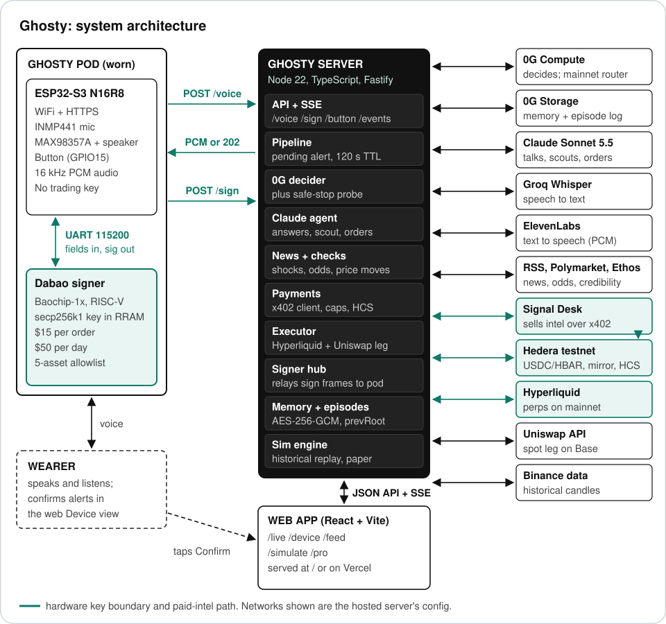
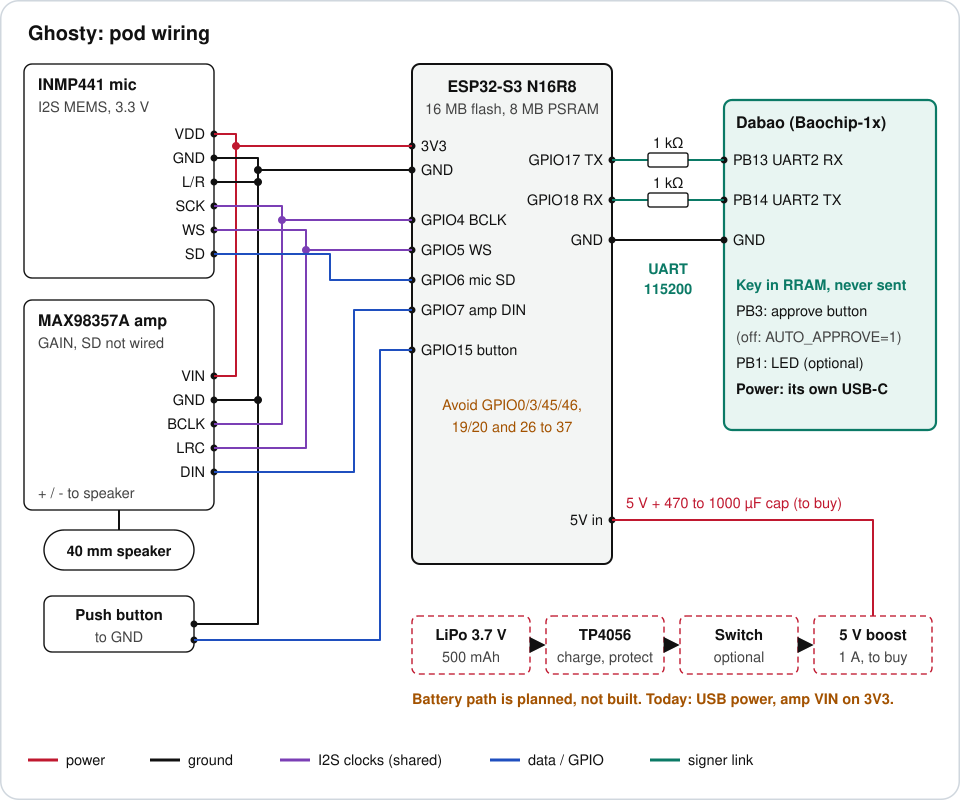

<p align="center">
  
</p>

<h3 align="center">Market intelligence. Trades only when you press.</h3>

<p align="center">
  <a href="https://ghosty-sepia.vercel.app"><b>Live app</b></a> ·
  <a href="https://ghosty-sepia.vercel.app/device"><b>Device</b></a> ·
  <a href="hardware/photos/ghosty-flow.mp4"><b>Demo video</b></a> ·
  <a href="docs/architecture.md"><b>Architecture</b></a> ·
  <a href="docs/evidence.md"><b>Evidence</b></a>
</p>

---

## Demo


Headlines and market odds stream in all day. Ghosty keeps the one headline that matters, decides what to do and writes that decision down before it says a word. The pod tells you in plain words, and nothing trades until you press the button. No press, no trade. Narrated version: [hardware/photos/ghosty-flow.mp4](hardware/photos/ghosty-flow.mp4).

## What it is

Ghosty is a small voice pod plus a server that does the heavy lifting. It reads market news for you, scores how credible each headline is, and speaks up when something moves gold, oil, crypto or stocks. Each alert decision is made on 0G Compute, logged to 0G Storage and a public Hedera topic, and informed by a second opinion the agent buys itself over x402. Trades go to Hyperliquid, with an optional Uniswap spot leg on Base, and only after you press the button.

Built at ETHGlobal Mumbai, Nov 6 to 8, 2026.

## How it works

<p align="center">
  
</p>

- **A headline lands.** The server polls RSS and Polymarket every 60 s, and a shock detector flags the ones that matter.
- **Ghosty buys a second opinion.** Its Hedera agent wallet pays the Signal Desk 0.01 USDC over x402 for an intel bundle (source credibility, outlet count, severity).
- **0G decides.** The headline, recent news, your memory and the paid bundle go to 0G Compute, which returns a signal, a confidence and legs sized to your cap.
- **Logged before it is spoken.** The decision goes to 0G Storage as an episode and to the Hedera audit topic.
- **The pod speaks and waits.** "Geopolitical shock. I suggest long gold. Press to confirm." Nothing trades without a press within 120 s.
- **Or just ask.** Speech to text, a research assistant that answers questions, and a voice reply. Spoken orders go through the same signer and limits.

More: [docs/architecture.md](docs/architecture.md)

## Hardware

<p align="center">
  
</p>

- **ESP32-S3 pod.** Handles WiFi, records and plays audio, and relays signing frames. It holds a device token, never a trading key.
- **Mic, speaker, button.** INMP441 mic and MAX98357A amp on one I2S port, a 40 mm speaker and a push button.
- **Dabao signer on UART.** A separate chip (Baochip-1x) holds the Hyperliquid API-wallet key, checks every order against its own limits (5 assets, $15 per order, $50 per day) and only then signs.
- Parts and wiring: [hardware/BOM.md](hardware/BOM.md), [hardware/wiring.md](hardware/wiring.md), [firmware/README.md](firmware/README.md).

## Sponsors we integrated

### 0G

- **Compute is the decision brain.** Every alert decision is a 0G Compute call with its own request ID. If 0G is unreachable, the pod says so and refuses alert trades (safe-stop).
- **Storage is the memory.** Your memory is encrypted (AES-256-GCM) on 0G Storage, and each decision is an episode chained to the previous one by `prevRoot`, so the history can be replayed and checked.
- **Why it matters:** the brain and the record of what it decided do not live on our server alone.
- **Evidence:** decision `bb6d851f-34c9-41f5-8a83-b7f755059320` (made with paid intel) in [HCS topic 0.0.11342727](https://hashscan.io/testnet/topic/0.0.11342727), message #3. On-chain Storage episode root: pending.

### Hedera

- **x402 payments.** Before each shock decision the agent wallet pays the Signal Desk, a separate merchant, in USDC (an HTS token) or HBAR, with no human approval and inside per-call and daily caps.
- **Verified and logged.** Ghosty re-checks each payment on the mirror node, then writes the payment and the decision to a public HCS audit topic.
- **Custody split.** The treasury key stays on the operator laptop; the server holds only a small agent hot wallet and an HCS submit key.
- **Why it matters:** the agent pays for its own information, and anyone can audit what it paid and decided.
- **Evidence:** [0.01 USDC payment](https://hashscan.io/testnet/transaction/0.0.9185802-1793984888-876950864), [0.01 HBAR payment](https://hashscan.io/testnet/transaction/0.0.9185802-1793984930-617250384), [audit topic](https://hashscan.io/testnet/topic/0.0.11342727). Walkthrough: [docs/hedera.md](docs/hedera.md).

### Uniswap

- **Spot leg on Base.** A confirmed alert can run a spot swap from native ETH to USDC through the Uniswap Trading API (approval check, quote, Permit2, swap).
- **Why it matters:** one press can move spot funds and open the hedge in the same flow.
- **Evidence:** code in [server/src/wallet/uniswap.ts](server/src/wallet/uniswap.ts), notes in [FEEDBACK.md](FEEDBACK.md). Swap tx: pending.

### Also used

- **Hyperliquid:** the execution venue for perps, including HIP-3 gold, oil and stocks. Ghosty trades through an API wallet that can trade but cannot withdraw.
- **Dabao chip:** the separate signer that keeps the trading key off the networked pod and the server.
- **Ethos and Polymarket:** source credibility scores and market odds that feed the news scout.

## Safety

- **You confirm every alert trade.** One press within 120 s, executed at most once.
- **Caps everywhere.** Trade size is capped on the server and again on the Dabao; x402 spend is capped per call and per day.
- **Safe-stop.** No 0G brain means no alert decision, never a cached or local fallback.
- **No withdraw rights.** Trading keys are Hyperliquid API wallets; the master key never touches the server.
- **Honest limit.** The server sees audio, transcripts and trades. Ghosty is user-owned, not zero-knowledge.

## Run it

```bash
cd server && cp .env.example .env    # fill the keys you need
npm ci && npm run doctor             # shows which providers are live
npm run dev                          # server on :3000
cd ../terminal && npm i && npm run dev   # web app on :5173
```

Live mode has no fakes: a missing key makes that provider answer `503 not_configured`. Server guide: [server/README.md](server/README.md). API: [docs/api.md](docs/api.md).

## Status

Hedera x402 payments are settled, mirror-verified and logged, and a 0G decision with paid intel is on the audit topic.
A real Hyperliquid fill, a Uniswap swap, a 0G Storage root and Dabao signing on hardware are still pending.
Every proof is listed in [docs/evidence.md](docs/evidence.md).

## Team

| Name | Role | Contact |
|---|---|---|
| Akshay Sharma | Product, server and agent | [@codeakki](https://github.com/codeakki) |
| Kenil Shah | Firmware and hardware | [@KENILSHAHH](https://github.com/KENILSHAHH) |
| Akhil Nanavati | Onchain integrations and simulation | [@Akhil-2310](https://github.com/Akhil-2310) |

## License

[MIT](LICENSE)
