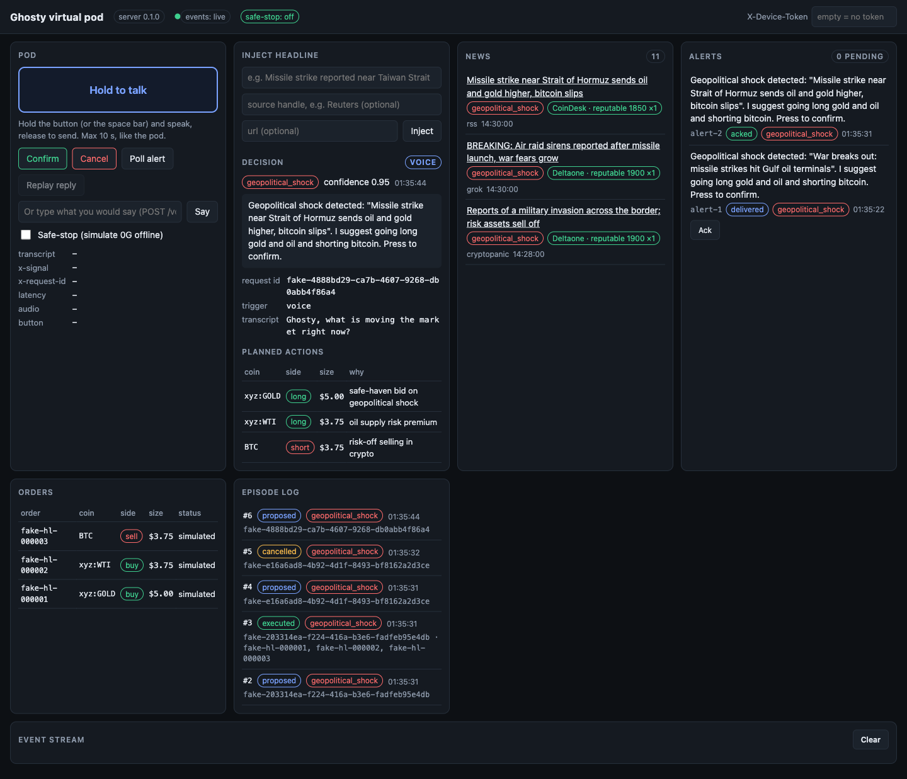

# Virtual pod simulator

Test the whole Ghosty pipeline without the ESP32: a browser page that acts as the pod, a CLI for scripts and
terminals, and an in-memory pod state you can watch live. The simulator talks to the **same** `/voice` and
`/button` routes as the firmware, so anything that works here works on the device. The extra routes it uses are
sim-only and are listed in [api.md](api.md#virtual-pod-sim-only).

```
browser /sim ─┐                         ┌─ GET /state      snapshot
pod CLI ──────┼─ POST /voice, /button ──┤  GET /events     live SSE stream
(curl) ───────┘  POST /voice/text       │  POST /news/inject → decision → alert queue
                 POST /sim/safe-stop    └─ GET /alerts/next, POST /alerts/:id/ack
                         │
                    Pipeline (STT → news → credibility → decide → TTS → button → orders → episode)
                         │ PipelineObserver
                    PodState (news, credibility, lastDecision, plannedActions, orders, episodes, safeStop, alerts)
```

## Screenshots



_Placeholder: add a GIF of a full hold-to-talk → alert → confirm run here (`docs/assets/simulator.gif`)._

## Start

```bash
cd server
npm install
npm run dev                    # http://localhost:3000
open http://localhost:3000/sim # or just visit it in a browser
```

- The browser only allows the microphone on `http://localhost` or HTTPS. On another machine on the LAN, use
  the **Say** text box (or the CLI) instead of hold-to-talk, or tunnel the port to localhost.
- If `DEVICE_TOKEN` is set in `server/.env`, paste it into the **X-Device-Token** field in the page header
  (kept in your browser's local storage). The CLI reads it from the environment or `server/.env`.

## What is on the page

| Panel | What it does |
|---|---|
| **Pod** | Hold **Hold to talk** (or the space bar), speak, release. The page records the mic, downsamples to 16 kHz mono 16-bit, adds a 44-byte WAV header and POSTs it to `/voice` exactly like the firmware, then plays the returned PCM. Shows transcript, `x-signal`, `x-request-id`, round-trip latency and audio sizes. Max 10 s, like the pod. |
| | **Confirm** / **Cancel** call `/button`. **Poll alert** calls `GET /alerts/next` as the firmware will. **Say** sends typed text through `/voice/text`. |
| | **Safe-stop** checkbox calls `POST /sim/safe-stop`; while it is on, `/voice` and `/button` answer `503 brain_offline`. |
| **Inject headline** | Adds a headline (optional source handle such as `Reuters`, used for credibility) and runs the decision loop. An actionable decision queues an alert. |
| **Decision / Planned actions** | Last decision with signal, confidence, rationale, 0G request id, trigger (`voice`, `text`, `button`, `inject`) and the trade legs waiting for a button press. |
| **News** | Every headline the pipeline has seen, newest first, with its keyword signal and Ethos credibility level, score and weight. |
| **Alerts** | Queued alerts with status `pending` → `delivered` (popped by `/alerts/next`) → `acked`. A new alert beeps and shows the yellow **Alert** banner. |
| **Orders / Episode log** | Fake Hyperliquid orders from confirmed decisions, and every episode (`proposed`, `executed`, `cancelled`) with its request id. |
| **Event stream** | Raw `news`, `decision`, `alert`, `order`, `episode` events from `GET /events`. |

## CLI

```bash
cd server
npm run pod -- help
```

| Command | Route | Notes |
|---|---|---|
| `say "<text>"` | `POST /voice/text` | Prints the decision JSON, saves the PCM reply to `/tmp/ghosty-say-*.pcm` |
| `wav <file.wav>` | `POST /voice` | Same bytes the pod sends. Prints status, latency and `x-*` headers, saves `/tmp/ghosty-reply-*.pcm` |
| `press confirm\|cancel` | `POST /button` | |
| `inject "<headline>" [--source <handle>] [--url <url>]` | `POST /news/inject` | |
| `state` | `GET /state` | Full JSON snapshot (`npm run -s pod -- state \| jq` to pipe it) |
| `watch` | `GET /events` | One line per event until Ctrl-C |
| `next` | `GET /alerts/next` | Prints `204 no pending alert` when empty |
| `ack <alert-id>` | `POST /alerts/:id/ack` | |
| `safe-stop on\|off` | `POST /sim/safe-stop` | |

Environment: `SERVER_URL` (default `http://localhost:$PORT`, else `:3000`), `DEVICE_TOKEN` (sent as
`X-Device-Token`), `POD_OUT_DIR` (default `/tmp`). Non-2xx answers print an error and exit with code 1.

Play a saved reply: `ffplay -autoexit -f s16le -ar 16000 -ac 1 /tmp/ghosty-say-….pcm`.

## Test script walkthrough

Run the server in one terminal and `npm run pod -- watch` in a second one so you can see every event. Then, in a
third terminal (or the browser):

1. **Health and state.**
   ```bash
   curl -s localhost:3000/health          # {"ok":true,"version":"0.1.0","safeStop":false}
   npm run -s pod -- state | jq '{news: (.news|length), alerts, lastDecision}'   # -s: no npm banner
   ```
   The news list is already filled from the fake feeds, each item with a credibility level.

2. **A war headline arrives.**
   ```bash
   npm run pod -- inject "War breaks out: missile strikes hit Gulf oil terminals" --source Reuters
   ```
   Expect `decision.signal: "geopolitical_shock"`, a rationale that quotes the headline, three planned legs
   (long `xyz:GOLD`, long `xyz:WTI`, short `BTC`) and `alert.status: "pending"`. In the browser the banner
   appears with a beep; `watch` prints `news`, `decision`, `episode`, `alert`.

3. **The pod picks up the alert.**
   ```bash
   npm run pod -- next     # the alert JSON: id, text, signal, actions, requestId, …
   npm run pod -- next     # 204 no pending alert
   npm run pod -- ack alert-1
   ```

4. **Confirm the trade.**
   ```bash
   npm run pod -- press confirm
   ```
   The `requestId` matches the injected decision, `executed: true`, three `simulated` orders. The Orders panel
   fills and the episode log shows `executed`.

5. **Talk to it.** In the browser hold the button and speak, or from the terminal:
   ```bash
   npm run pod -- say "Ghosty, is anything moving gold right now?"
   python3 -c "import wave; w=wave.open('/tmp/x.wav','wb'); w.setnchannels(1); w.setsampwidth(2); w.setframerate(16000); w.writeframes(b'\0\0'*16000); w.close()"
   npm run pod -- wav /tmp/x.wav           # 200, x-signal, x-request-id, 16000 bytes of PCM
   ```

6. **Safe-stop.**
   ```bash
   npm run pod -- safe-stop on
   npm run pod -- say "hello"              # error: POST /voice/text → 503 (safe-stop engaged: brain offline)
   curl -s localhost:3000/health           # "safeStop":true
   npm run pod -- safe-stop off
   ```
   On the real pod, the same 503 makes it blink the red LED 3 times and play nothing.

## Known limits

- **Fakes everywhere.** STT always returns a fixed question, TTS is a 0.5 s 440 Hz tone, and the decider is a
  keyword matcher. The fake RSS feed always carries a missile-strike headline, so every decision is
  `geopolitical_shock` unless you build the app with a quiet feed (the tests do). A benign injected headline
  therefore still produces an alert, and its rationale quotes the fake headline instead of yours.
- **In memory only.** State, alerts and injected headlines vanish on restart (`tsx watch` restarts on every save).
- **No auth on reads.** `GET /state`, `GET /events` and `GET /sim` are open even when `DEVICE_TOKEN` is set,
  because `EventSource` cannot send headers. Everything that acts checks the token.
- **Firmware does not poll yet.** `GET /alerts/next` is shaped for a later firmware poll; today only the
  simulator calls it.
